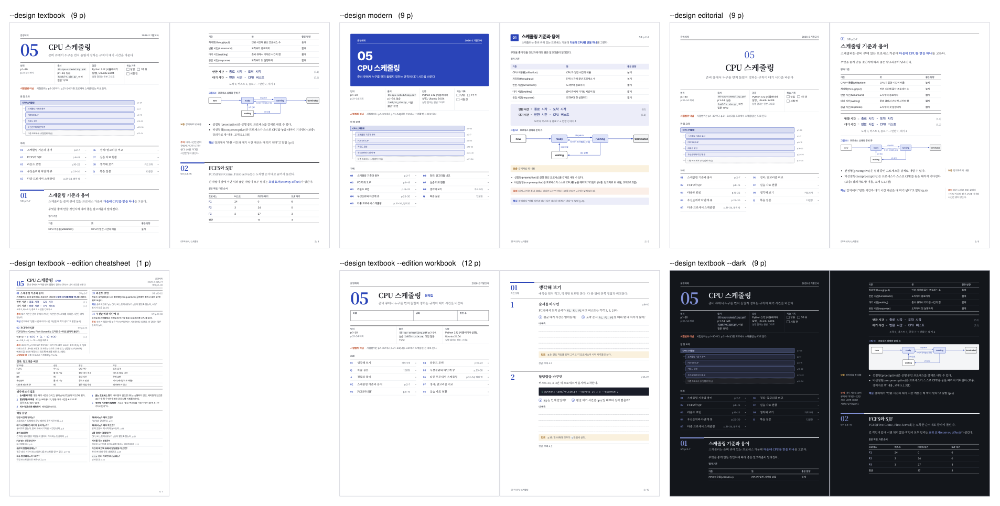

# AI Skills

개인용 AI 스킬 모음입니다. `.skill` 파일 하나가 스킬 폴더 하나(ZIP)이고, 자세한 사용법은 그 안의 `SKILL.md`에 있습니다.

## course-study-builder: 공부 자료 스킬

수업 자료 한 단위(강의 한 주, 교재 한 장, 자격증 한 과목)를 **검증된 시험 대비 PDF**로 만듭니다. 프로그래밍과 수학뿐 아니라 역사, 법, 경제, 어학처럼 줄글과 인용이 많은 과목도 같은 방식으로 다룹니다.

```
강의 자료·실습·내 질문·시험 정보 → 읽기와 검증 → _study/STUDY.md → 조판 → PDF
```

만들어 주는 것:

- 자료 순서대로 정리한 개념, 표, 그림, 공식 (모든 내용에 원본 쪽 번호)
- 직접 풀어 보는 생각 카드(예측형, 토론형, 서술형)와 복습 질문
- 실행하거나 다시 계산하거나 원문과 대조한 것만 사실로 적고, 확인하지 못한 것은 `(미검증)`으로 표시
- 강의에서 "시험에 낸다"고 한 부분 표시와 그에 맞춘 문제

### 설치

- **Claude 앱**: Customize > Skills에서 `course-study-builder.skill`을 올립니다. 코드 실행과 파일 만들기 기능이 켜져 있어야 합니다. ([안내](https://support.claude.com/en/articles/12512180))
- **Claude Code**: 압축을 풀어 `~/.claude/skills/course-study-builder/`에 둡니다. Codex 같은 다른 도구는 그 도구의 스킬 폴더에 같은 방식으로 둡니다.
- PDF를 만들 컴퓨터에 필요한 것: Python 3, Chrome이나 Edge(131 이상), PyMuPDF(`pip install pymupdf`). 글꼴과 수식 조판기는 스킬에 들어 있습니다.

### 쓰는 법

자료를 주고 평소 말로 부탁하면 됩니다.

| 이렇게 말하면 | 이렇게 됩니다 |
|---|---|
| "7주차 강의자료로 공부 자료 만들어 줘" | 읽기, 검증, 정리, PDF까지 |
| "초안으로 빠르게" | 미리보기 확인을 줄인 가벼운 판 |
| "기말 범위(9~14주) 묶어 줘" | 이미 만든 단원들을 한 권으로 (다시 쓰지 않음) |
| "시험 직전용 요약판", "A4 한 장 치트시트" | 1~2쪽 요약판 (한 장은 `--fit 1`) |
| "문제집으로" | 같은 내용을 풀기용으로 |
| "흑백 프린터로 뽑을 거야", "밤에 태블릿으로 볼 거야" | 회색조 인쇄판, 어두운 화면판 |
| "디자인 견본 보여 줘", "이런 느낌으로 바꿔 줘" | 모든 디자인 견본 한 장, 원하는 느낌의 새 디자인 |

### 디자인

디자인은 세 가지를 골라 겹칩니다. 과목을 **처음 쓸 때 한 번** 모양, 함께 만들 판(요약판·문제집), 보는 방법(컬러·흑백·화면)을 묻고, 답을 과목 폴더의 `_course.md`에 적어 둡니다. 그 뒤로는 묻지 않고 같은 설정으로 만들며, "이 과목은 모던으로"처럼 말하면 언제든 바뀝니다. 다른 판은 같은 `STUDY.md`에서 다시 찍기만 하므로 내용을 새로 쓰지 않습니다.



| 축 | 선택지 | 이럴 때 |
|---|---|---|
| 모양 | 수험서 (기본) | 명조 본문, 왼쪽 날개 메모. 어느 과목이든 |
| | 모던 | 고딕, 색 면 표지. 코드와 표가 많거나 명조가 딱딱할 때 |
| | 인문형 | 명조 한 단, 오른쪽 메모, 큰 인용문. 역사, 문학, 법, 철학, 사회 |
| 용도 | 정독판 (기본) | 처음 공부하고 복습하는 본문 |
| | 요약판 | 시험 직전 1~2쪽: 핵심 문장, 공식, 시험 신호, 함정, 정리 표, 문답 |
| | 문제집 | 문제 먼저, 답 쓰는 칸, 정답은 문제 바로 아래, 개념 정리는 뒤 |
| 매체 | 인쇄 (기본), 흑백 | 컬러 또는 흑백 프린터 |
| | 화면용 | 어두운 바탕. 밤에 모니터나 태블릿으로 읽을 때 |

- 셋에 맞는 것이 없으면 원하는 느낌을 말하면 됩니다. 스킬이 과목 폴더에 `_design.css`로 새 모양을 만들어 견본을 보여 주고, 마음에 들면 계속 씁니다.
- 수식은 `$\sigma(z)$`처럼 TeX로 쓰면 분수, 첨자, 그리스 문자가 제대로 조판됩니다. 인터넷 없이도 됩니다.

### 폴더와 파일

```
한국사의이해/
  _course.md                    과목 공통 정보: 시험 범위와 날짜, 과제 규정, 고른 디자인
  03_조선전기/
    강의/ 실습/ 과제/ 메모/       원본 자료 (이동만 하고 지우거나 덮어쓰지 않음)
    _study/STUDY.md             내용 파일 (기계용, 구조는 영어·찍히는 글은 한국어)
    _study/verify.md            무엇을 어떻게 확인했는지 기록
    3장_공부자료(조선 전기의 통치 체제).pdf
```

- **고치는 곳**: 내용과 그림은 `STUDY.md`. `sheet.html`은 빌드 산출물이라 고치지 않습니다.
- **단원 호칭**: 기본은 "주차"이고, 교재나 자격증 공부는 `unit_label`로 "장", "강", "단원"을 씁니다.
- **읽기 쉬움**: 모든 글자는 바탕과 4.5:1 이상 대비가 나야 하고, 빌드가 PDF에서 재서 알려 줍니다.

### 스킬 안의 구성

| 파일 | 하는 일 |
|---|---|
| `SKILL.md` | 순서와 디자인 고르는 법 |
| `reference/content.md`, `format.md` | 무엇을 쓰는지, `STUDY.md` 문법 |
| `reference/designs.md`, `figures.md`, `design-system.md` | 디자인 고르기와 새 모양 만들기, 손으로 그리는 그림, CSS를 고칠 때 |
| `scripts/build.py` | 점검 → HTML → PDF → PDF 점검 → 미리보기 (이것 하나만 실행) |
| `scripts/extract.py` | PDF와 PPTX에서 쪽별 글자 뽑기 |
| `scripts/pack.py`, `export_bank.py` | 시험 범위 묶음, 문제은행(JSON) 내보내기 |
| `assets/` | 기본 CSS, 모양·용도·매체별 CSS, 글꼴, 수식(KaTeX) |

`_backup_*/`와 `study-skills-dev.zip`은 로컬 전용이라 커밋하지 않습니다.
