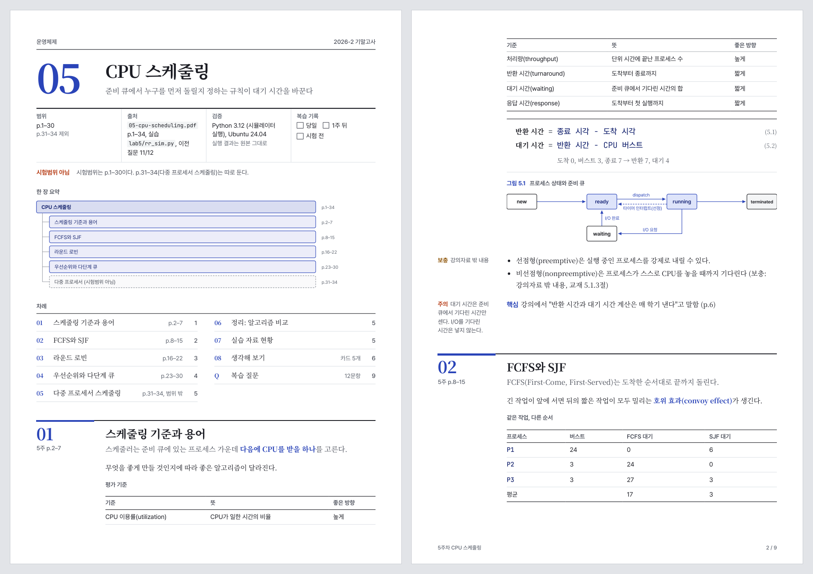
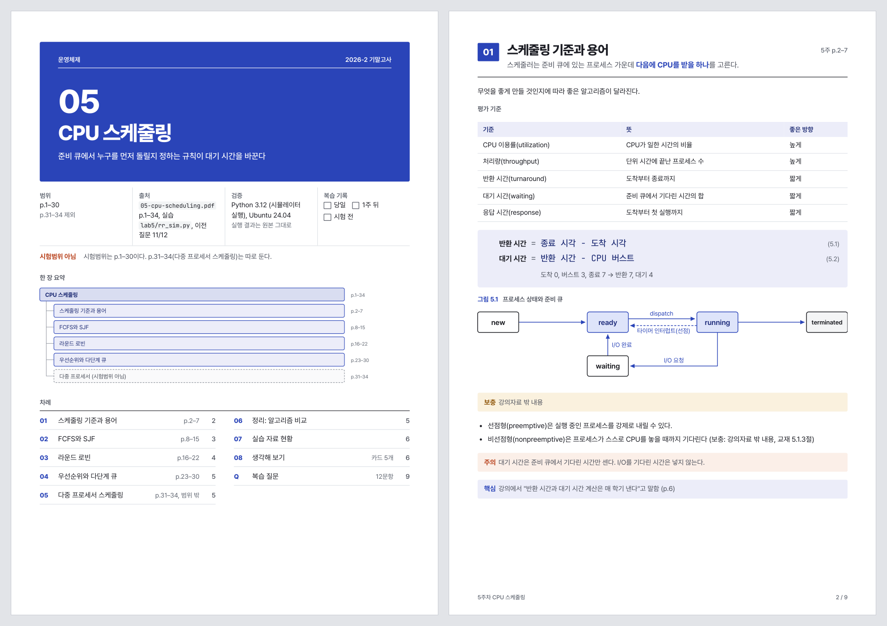
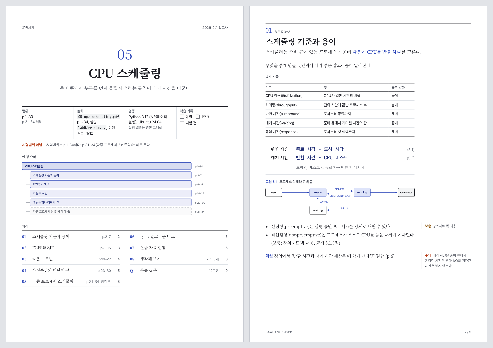
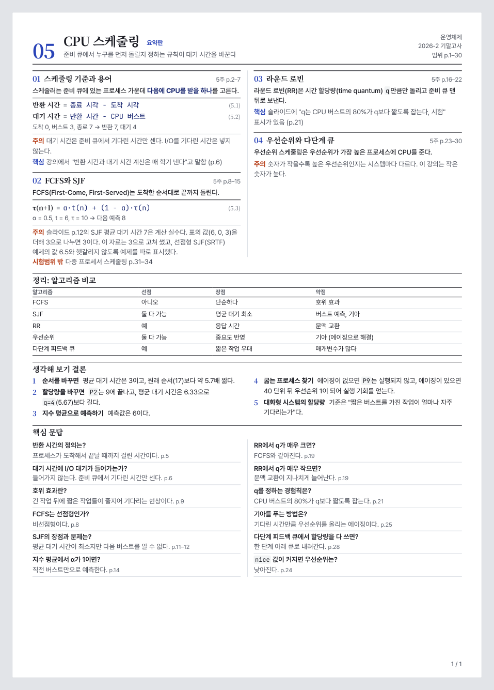
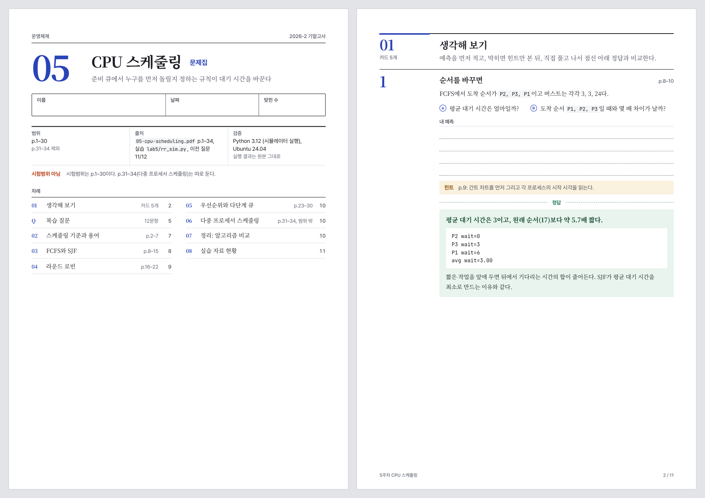
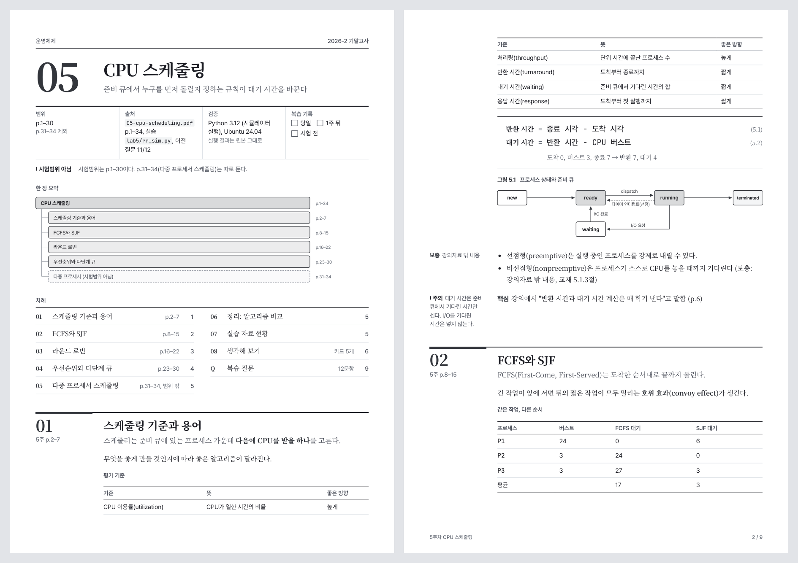
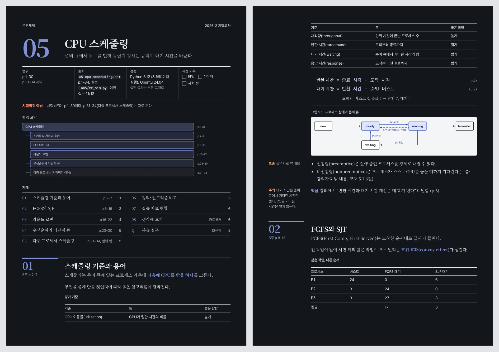

# course-study-builder

수업 자료 한 단위(강의 한 주, 교재 한 장, 자격증 한 과목)를 **시험 대비 PDF**로 만들어 주는 AI 스킬입니다. 슬라이드를 예쁘게 옮기는 게 아니라, 읽고 확인한 내용으로 직접 공부하고 스스로 시험해 볼 수 있는 자료를 만드는 게 목적입니다.

프로그래밍과 수학뿐 아니라 역사, 법, 경제, 어학처럼 줄글이 많은 과목에도 쓸 수 있습니다. Claude(앱, Claude Code)와 Codex 같은 다른 AI 도구에서 씁니다.

`course-study-builder.skill`이 스킬 파일입니다. 내용은 ZIP 압축 파일과 같아서 확장자를 `.zip`으로 바꾸면 그대로 풀 수 있습니다.



## 무엇이 들어가나

- **개념 정리**: 자료 순서대로 정리한 설명, 표, 그림, 공식. 모든 내용에 원본 쪽 번호가 붙습니다(`p.12`, 파일이 여럿이면 `06 p.45`).
- **생각 카드**: 먼저 예측하고 풀어 본 뒤 정답과 비교하는 문제. 힌트와 정답이 카드 바로 아래에 있습니다.
- **복습 문제**: 단원 끝 문답 표.
- **확인 표시**: 코드는 실행하고, 계산은 다시 하고, 인용은 원문과 대조한 것만 사실로 적습니다. 확인하지 못한 것은 `(미검증)`, 자료 밖 내용은 `(보충)`으로 표시합니다.
- **시험 신호**: 강의에서 "시험에 낸다"고 한 부분을 표시하고, 그에 맞춘 문제를 넣습니다.

## 설치

| 쓰는 곳 | 방법 |
|---|---|
| Claude 앱 (웹·데스크톱) | 설정 > Capabilities에서 코드 실행과 파일 만들기를 켜고, Skills에 `course-study-builder.skill`을 올립니다. ([안내](https://support.claude.com/en/articles/12512180)) |
| Claude Code | 압축을 풀어 `~/.claude/skills/course-study-builder/`에 둡니다. |
| Codex 등 다른 도구 | 압축을 풀어 그 도구의 스킬 폴더(Codex는 `~/.codex/skills/`)에 같은 이름으로 둡니다. 안의 `SKILL.md`가 설명서입니다. |

PDF를 만드는 컴퓨터에는 Python 3, Chrome이나 Edge, PyMuPDF(`pip install pymupdf`)가 있어야 합니다. 글꼴과 수식 조판기는 스킬에 들어 있어서 인터넷 없이도 됩니다.

## 처음 쓸 때

과목에서 처음 쓰면 한 번만 세 가지를 묻습니다.

1. **모양**: 수험서, 모던, 인문형 중 하나
2. **함께 만들 판**: 요약판, 문제집 (없어도 됨)
3. **보는 방법**: 컬러 인쇄, 흑백 인쇄, 화면용

답은 과목 폴더의 `_course.md`에 적어 두고, 그 뒤로는 묻지 않고 같은 설정으로 만듭니다. 바꾸고 싶으면 "이 과목은 모던으로"처럼 말하면 됩니다. 시험 범위나 날짜, 과제 규정을 말해 두면 그것도 같은 파일에 적어 두고 계속 반영합니다.

## 이렇게 말하면 됩니다

자료를 올리거나 폴더를 알려 주고 평소 말로 부탁하면 됩니다.

| 이렇게 말하면 | 이렇게 됩니다 |
|---|---|
| "7주차 강의자료로 공부 자료 만들어 줘" | 읽기, 확인, 정리, PDF까지 전부 |
| "초안으로 빠르게" | 확인을 줄인 가벼운 판. 사용량이 적게 듭니다 |
| "요약판도 뽑아 줘", "A4 한 장으로" | 시험 직전용 1~2쪽 요약 |
| "문제집으로" | 같은 내용을 풀기용으로 |
| "흑백 프린터로 뽑을 거야", "밤에 태블릿으로 볼 거야" | 흑백판, 어두운 화면판 |
| "기말 범위(9~14주) 묶어 줘" | 이미 만든 단원들을 한 권으로 |
| "디자인 견본 보여 줘", "좀 더 이런 느낌으로" | 디자인 견본, 원하는 느낌의 새 디자인 |
| "객관식 문제도 만들어 줘" | 객관식·OX·빈칸 문제 추가, 문제은행(JSON)으로 내보내기 |

요약판, 문제집, 흑백판, 다른 디자인은 이미 만든 내용을 다시 찍기만 하므로 내용을 새로 쓰지 않고 금방 나옵니다.

## 디자인 선택지

| 종류 | 선택지 | 이럴 때 |
|---|---|---|
| 모양 | **수험서** (기본) | 명조 본문, 왼쪽 여백 메모. 어느 과목이든 |
| | 모던 | 고딕, 색 면 표지. 코드와 표가 많거나 명조가 딱딱할 때 |
| | 인문형 | 명조 한 단, 오른쪽 메모, 큰 인용문. 역사, 문학, 법, 철학, 사회 |
| 판 | **정독판** (기본) | 처음 공부하고 복습하는 본문 |
| | 요약판 | 시험 직전 1~2쪽: 핵심 문장, 공식, 함정, 정리 표 |
| | 문제집 | 문제가 먼저, 답 쓰는 칸 바로 아래에 정답, 개념 정리는 뒤 |
| 보는 방법 | **컬러 인쇄** (기본), 흑백 | 프린터에 맞춰 |
| | 화면용 | 어두운 바탕. 밤에 모니터나 태블릿으로 읽을 때 |

### 견본

같은 단원(운영체제 5주차, CPU 스케줄링)을 각 디자인으로 찍은 첫 두 쪽입니다.

**모양: 수험서** (기본)


**모양: 모던**



**모양: 인문형**



**판: 요약판** (A4 한 장)



**판: 문제집** (답 쓰는 칸 바로 아래 정답)



**보는 방법: 흑백**



**보는 방법: 화면용**



셋 다 마음에 안 들면 원하는 느낌을 말하면 됩니다. 과목 폴더에 새 모양(`_design.css`)을 만들어 견본을 보여 주고, 마음에 들면 그 과목에서 계속 씁니다.

## 폴더 모습

```
한국사의이해/
  _course.md                      과목 설정: 디자인, 시험 범위와 날짜, 과제 규정
  03_조선전기/
    강의/ 실습/ 과제/ 메모/         원본 자료 (정리만 하고 지우거나 덮어쓰지 않음)
    _study/STUDY.md               내용 파일
    _study/verify.md              무엇을 어떻게 확인했는지 기록
    3장_공부자료(조선 전기의 통치 체제).pdf
    3장_공부자료(조선 전기의 통치 체제)_요약판.pdf
```

- 내용을 고치고 싶으면 "카드 3번 바꿔 줘"처럼 말하면 `STUDY.md`를 고쳐 다시 찍습니다.
- 단원 이름은 기본이 "주차"이고, 교재나 자격증 공부면 "장", "강", "단원"으로 바뀝니다.
- 한 단원에 강의 파일이 여러 개여도 됩니다. 파일마다 쪽 번호를 따로 적고, 빠뜨린 쪽이 없는지도 파일별로 확인합니다.

## 지켜 주는 것

- **과제는 풀어 주지 않습니다.** 아직 안 낸 과제는 개념과 접근법만 설명합니다. 과목에 AI 사용 규정이 있으면 연습 문제와 빈칸 문제도 같은 방식으로 다룹니다.
- **직접 만든 문제를 기출이라고 하지 않습니다.**
- **자료가 서로 다르면** 어느 쪽을 따랐고 왜인지 표시합니다.
- **빈칸 실습의 가려진 정답**은 자료에서 읽어 오지 않습니다.
- **읽기 쉬움**: 모든 글자가 바탕과 충분히 대비되는지 PDF에서 직접 재서 확인합니다.

## 스킬 안의 구성

| 파일 | 하는 일 |
|---|---|
| `SKILL.md` | 전체 순서와 규칙 (AI가 읽는 설명서) |
| `reference/` | 내용 쓰는 법, `STUDY.md` 문법, 디자인, 그림 |
| `scripts/build.py` | 점검 → PDF → PDF 점검 → 미리보기. 이것 하나만 실행 |
| `scripts/extract.py` | PDF와 PPTX에서 쪽별 글자 뽑기 |
| `scripts/pack.py`, `export_bank.py` | 시험 범위 묶음, 문제은행 내보내기 |
| `assets/` | CSS, 글꼴, 수식(KaTeX), 예시 |

`_backup_*/`(예전 버전 보관)와 `_Claude_outputs/`(예시 결과물)는 로컬 전용이라 커밋하지 않습니다.
